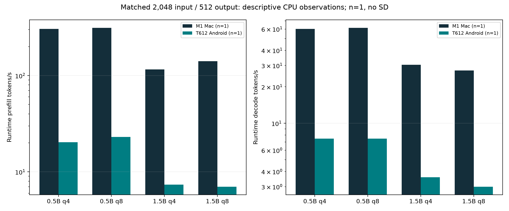

# Efficiency profiling of small language models on edge hardware

**Adam Dalwai, Mahean Seam, and Vrushti Patel**

CPU inference measurements of Qwen2.5-0.5B/1.5B Instruct on an Apple M1 MacBook Air (8 GB) and realme RMX3930/T612 Android phone (5.63 GiB OS-visible RAM). Each device completed 24 configurations once: two model sizes × Q4_K_M/Q8_0 weights × 256/1,024/2,048 input tokens × 128/512 output tokens.

These are **48 exploratory observations, n=1 per configuration/device**. They support descriptive comparisons, with no standard deviation, significance, repeatability, or strict thermal-stabilization claim. The original [assignment objectives](PROJECT_OBJECTIVES.md) call for repeated measurements and additional profiling; those remain incomplete. See the [protocol and measurement boundaries](docs/protocol.md).

## View the results

- [Two-device comparison and complete numerical table](analysis/two-device-android-20261115-presentation-usb/COMPARISON.md).
- [Matched observations CSV](analysis/two-device-android-20261115-presentation-usb/matched_observations.csv) and [workload-identity audit](analysis/two-device-android-20261115-presentation-usb/audit.json): all 24 pairs use identical prompt text, token IDs, and request JSON.
- [Mac observations CSV](analysis/mac-20261113-presentation-v2/validated_runs.csv) and [coverage audit](analysis/mac-20261113-presentation-v2/audit.json).
- [Android summary](analysis/android-20261115-presentation-usb/SUMMARY.md), [observations CSV](analysis/android-20261115-presentation-usb/validated_runs.csv), and [coverage audit](analysis/android-20261115-presentation-usb/audit.json).



At 2,048 input / 512 output tokens, Android 1.5B Q8_0 decoded at 2.993 tokens/s, with 463.64 s request wall time and 1,677 MiB sampled peak RSS; Q4_K_M observed 3.583 tokens/s, 420.60 s, and 1,292 MiB. Android inference energy is unavailable. Mac energy estimates cover CPU/GPU/ANE components during the request, not whole-device or isolated decode energy. Different CPU kernels, operating systems, thermal histories, memory accounting, and sensor cadences prevent a hardware-only causal comparison.

## Regenerate the published analysis

No phone, model download, or inference runtime is needed to check the saved evidence. Use Python 3.11 or later:

```sh
python3 -m venv .venv
. .venv/bin/activate
python3 -m pip install -r requirements.txt
python3 analysis/analyze.py --session mac-20261113-presentation-v2
python3 analysis/analyze_android.py --session android-20261115-presentation-usb
python3 analysis/compare_devices.py --android-session android-20261115-presentation-usb
python3 scripts/verify_evidence.py
```

The analyzers regenerate CSV/JSON, audit coverage and token/timing checks, and plots. The final verifier checks the retained evidence manifest, frozen source/config hashes, and 24/24 paired coverage. Plot bytes may vary with the rendering environment; numerical records must agree.

## Run new experiments

The runtime is llama.cpp commit `79967ec596c0dacfd2251b085a57e79df292b1cc`, CPU only, four threads, one request, F16 KV cache, and 3,072 context capacity. Models, revisions, download URLs, sizes, and SHA-256 checksums are pinned in [configs/models.json](configs/models.json). Fixed output budgets use `ignore_eos`; this measures fixed work, not conversational stopping quality.

For Mac, install Git, curl, CMake, Xcode command-line tools, and `macmon` (`brew install cmake macmon`). The collector expects `/opt/homebrew/bin/macmon`. Then:

```sh
python3 scripts/fetch_models.py
sh scripts/build_runtime.sh
python3 scripts/run_study.py --session mac-NEW-presentation \
  --study-config configs/presentation-pilot.json
python3 analysis/analyze.py --session mac-NEW-presentation
```

Use a fresh session ID and retain all logs, including failures. Do not rerun inference into the published session folders. [Android reproduction](docs/android-handoff.md) covers NDK build, transfer, checksums, smoke/pilot, and the exploratory matrix. [Device inventory](docs/android-device.md) records the actual platform and monitoring limits. New builds and sensor conditions can produce different observations; hashes identify the historical binaries.

## Repository contents

| Path | Purpose |
| --- | --- |
| `scripts/`, `analysis/*.py` | Model retrieval, pinned runtime builds, measurement, and analysis |
| `configs/`, `prompts/` | Workloads, model manifest, exploratory settings, and separate full controlled protocol |
| `results/mac-20261113-presentation-v2/` | Frozen Mac session, requests, responses, timings, logs, and sampled sensors |
| `results/android-20261115-presentation-usb/` | Frozen Android session and complete raw evidence |
| `results/android-20261115-pilot-{v2,dotprod}/` | Largest-condition warm-up and inherited idle-reference provenance; excluded from headline observations |
| `results/*setup/`, `results/android-readiness-20261115/` | Build and selected device inventory evidence |
| `analysis/*/` | Derived tables, plots, and audits |
| `docs/` | Protocol, device boundaries, and reproduction instructions |

[Evidence manifest](docs/evidence-manifest.json) records SHA-256 and size for every retained raw-evidence file. Raw session harness copies preserve the code actually used; executable entry points are under `scripts/`. Weights and runtime binaries are retrieved/built outside Git. Reports, slides, video production files, internal planning, and abandoned setup attempts are maintained separately from this reproduction repository.
